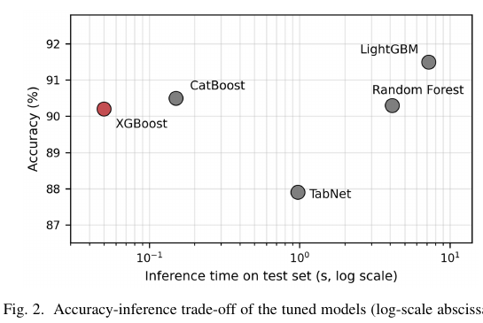

# Latency-Aware Interpretable and Causal Counterfactual Analysis for Diabetic Readmission Prediction

Code for the IEEE CARS 2026 paper by Shafak Shahriar Sozol, M. Rubaiyat Hossain Mondal and Utku Kose.

Five classifiers (CatBoost, Random Forest, XGBoost, LightGBM, TabNet) predict 30-day readmission
of diabetic patients. The reference model is chosen on accuracy and inference latency, then
explained with SHAP, GEMEX, DirectLiNGAM and a DR-Learner.



## Structure

```text
├── data/          # place diabetic_data.csv here (not included)
├── figures/       # Fig. 2 and Fig. 3 from the paper
├── results/       # Tables II–V (CSV)
├── src/
│   ├── config.py         # paths, seed, tuned hyperparameters, feature groups
│   ├── preprocessing.py  # cleaning, ICD-9 grouping, encoding
│   ├── train.py          # SMOTE, 75:25 split, scaling, training (Table III, Fig. 2)
│   ├── models.py         # model factories, Optuna search spaces
│   ├── evaluation.py     # metrics and inference time
│   ├── explain.py        # SHAP and GEMEX
│   ├── causal.py         # DirectLiNGAM and DR-Learner
│   ├── consensus.py      # consensus ranking (Table IV)
│   └── analysis.py       # plots from saved results
├── requirements.txt
└── LICENSE
```

## Usage

```bash
pip install -r requirements.txt
python -m src.train                  # add --device cuda for GPU
```

SHAP, GEMEX and causal analyses are available as functions in `src/explain.py` and `src/causal.py`.

## Key results

| Model (tuned) | Accuracy (%) | AUROC (%) | Inference (s) |
|---|---|---|---|
| LightGBM | 91.5 | 96.5 | 7.22 |
| **XGBoost** | **90.2** | **95.7** | **0.05** |

Full tables are in [`results/`](results/).

## Notes

- As stated in the paper, SMOTE is applied before the train–test split; resampling within training folds only is left for future work.
- `src/config.py` uses the Table II hyperparameters, so re-runs may differ slightly from the reported values.

## License

MIT. See [`LICENSE`](LICENSE). The dataset is subject to its own terms and is not redistributed.

## Citation

```bibtex
@inproceedings{sozol2026latency,
  title     = {Latency-Aware Interpretable and Causal Counterfactual Analysis for Diabetic Readmission Prediction},
  author    = {Sozol, Shafak Shahriar and Mondal, M. Rubaiyat Hossain and Kose, Utku},
  booktitle = {2026 Cyber Awareness and Research Symposium (CARS)},
  publisher = {IEEE},
  year      = {2026}
}
```
